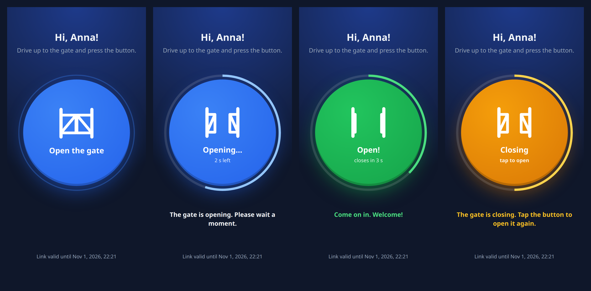

# ha-sip-gate-opener

Let guests open your driveway gate from their phone with a temporary link, using
[Home Assistant](https://www.home-assistant.io/). Your Home Assistant doesn't need to be exposed to the internet.



You send a guest a link like `https://gate.example.com/AQAAAABq…`. It works without logging in until it
expires (e.g. after 24 hours). The page has one big button. The button calls a Home Assistant webhook, and
your automation opens the gate. It was built for gates with a GSM/SIP controller that opens when called,
using the [ha-sip](https://github.com/arnonym/ha-sip) add-on. It works with any gate that Home Assistant can
open (switch, cover, script…).

## Features

- **Temporary, signed links.** No database and no accounts. Each link carries its expiry time and the guest's
  name, signed with HMAC-SHA256. You can revoke a single link or all of them.
- **Built for phones.** One large button with haptic feedback. The page is in English or Polish, chosen from
  the phone's language.
- **Live gate state.** The icon follows the gate's real cycle: opening, open, then closing, with a progress
  ring. The server keeps the cycle, so a page reload or a second guest sees the same state. The button is
  locked while the gate opens or stays open. While the gate is closing, a tap opens it again.
- **Safe by default.**
  - Opening the page (GET) never opens the gate, so link previews in messengers are harmless.
  - The button sends a same-origin POST only.
  - Strict CSP, no cookies, no third-party resources.
  - The app has no Home Assistant token. It only knows a secret webhook ID, and the webhook is accepted only
    from your LAN.
- **Notifications.** Home Assistant gets the guest's name, link ID and IP, so it can notify you who opened
  the gate.
- **Small.** One static Go binary (stdlib only) in a distroless image of about 10 MB, for
  amd64/arm64/armv7 (Raspberry Pi).

## How it works

```
guest's phone ──HTTPS──▶ reverse proxy ──▶ gate-opener ──POST webhook──▶ Home Assistant ──▶ ha-sip ──▶ ☎ gate
                                          (in your LAN)   {name, token_id, ip}
```

## Setup

### 1. Home Assistant automation

Create a webhook ID, a long random string: `openssl rand -hex 24`.

Add the automation from [`deploy/home-assistant/automation.yaml`](deploy/home-assistant/automation.yaml).
Open Settings → Automations & Scenes → Create automation → ⋮ → Edit in YAML, paste it, then change:

- `webhook_id`: your webhook ID.
- `addon` and `number`: the ha-sip add-on slug and the number that opens your gate. Copy them from the
  action you already use to open the gate. Without ha-sip, replace this action with e.g.
  `switch.turn_on` or `cover.open_cover`.
- `notify.mobile_app_…`: your phone, or remove that action.

The webhook URL is `http://<home-assistant>:8123/api/webhook/<webhook ID>`. Treat it like a password.

> `local_only: true` makes Home Assistant accept the webhook only from your local network, so the app must
> run in your LAN.

### 2. Run the app

Create a signing key with `openssl rand -base64 32`. Changing the key later invalidates all links.

**Docker Compose.** See [`deploy/docker/`](deploy/docker):

```bash
cd deploy/docker
cp .env.example .env && chmod 600 .env   # fill in GATE_SECRET, GATE_WEBHOOK_URL, GATE_BASE_URL
docker compose up -d
```

**Kubernetes.** There is a [Kustomize](https://kustomize.io/) base in
[`deploy/kubernetes/`](deploy/kubernetes). Example overlay:

```yaml
# kustomization.yaml
namespace: gate
resources:
  - namespace.yaml   # your Namespace "gate"
  - https://github.com/q84fh/ha-sip-gate-opener//deploy/kubernetes?ref=v1.0.0
images:
  - name: ghcr.io/q84fh/ha-sip-gate-opener
    newTag: "1"        # or pin an exact version, e.g. "1.1.0"
configMapGenerator:
  - name: gate-opener
    behavior: merge
    literals:
      - GATE_BASE_URL=https://gate.example.com
      - TZ=Europe/Warsaw
patches:
  - target: {kind: Ingress, name: gate-opener}
    patch: |
      - {op: replace, path: /spec/rules/0/host, value: gate.example.com}
      - {op: replace, path: /spec/tls/0/hosts/0, value: gate.example.com}
      - {op: add, path: /spec/ingressClassName, value: nginx}
      - {op: add, path: /metadata/annotations/cert-manager.io~1cluster-issuer, value: letsencrypt}
```

```bash
kubectl create namespace gate
kubectl -n gate create secret generic gate-opener \
  --from-literal=GATE_SECRET="$(openssl rand -base64 32)" \
  --from-literal=GATE_WEBHOOK_URL=http://homeassistant.local:8123/api/webhook/<webhook ID>
kubectl apply -k .
```

**Binary.** Build it with `go build`, or use `make build`.

```bash
GATE_SECRET=… GATE_WEBHOOK_URL=… ./gate-opener serve
```

### 3. Make it reachable from the internet

Put the app behind a reverse proxy with HTTPS: Caddy, nginx, Traefik, an ingress controller, or a Cloudflare
Tunnel. Expose only this app, not Home Assistant. Set `GATE_IP_HEADER` to the header your proxy uses for the
client IP, so logs and notifications show the guest's real IP. The proxy must overwrite that header,
otherwise guests can fake it. With Caddy, add `header_up X-Real-IP {remote_host}`. Rate limiting at the
proxy is a good idea. The Kubernetes ingress sets it for ingress-nginx.

### 4. Send links to guests

The signing key stays in the app. Create links inside the container:

```bash
docker compose exec gate-opener /gate-opener token -ttl 24h -name Ann
kubectl -n gate exec deploy/gate-opener -- /gate-opener token -ttl 2d -name Ann
```

```
https://gate.example.com/AQAAAABq560xG5kUQ8IgQW5uYfEZEoo9cGKidNOJp1AumPQ
Valid until: 2026-11-01 22:21 CET, ID: 6a42ec3f1b2c
```

- `-ttl`: how long the link is valid, e.g. `90m`, `12h`, `2d`, `1d12h`.
- `-name`: optional, up to 40 bytes. The name is shown to the guest, written to the logs and sent to Home
  Assistant.

Other commands:

- `gate-opener inspect <link>`: shows the name, expiry and status of a link.
- To revoke one link, add its ID to `GATE_REVOKED` (comma-separated) and restart the app.
- To revoke all links, change `GATE_SECRET`.

## Configuration

| Variable | Default | Description |
|---|---|---|
| `GATE_SECRET` | – (required) | HMAC key, base64, at least 32 bytes |
| `GATE_WEBHOOK_URL` | – (required) | Home Assistant webhook URL |
| `GATE_BASE_URL` | `http://localhost:8080` | public URL, used in links printed by `token` |
| `GATE_OPENING` | `25s` | how long the gate takes to open |
| `GATE_OPEN_HOLD` | `10s` | how long it stays open |
| `GATE_CLOSING` | `25s` | how long it takes to close |
| `GATE_REVOKED` | – | revoked link IDs, comma-separated |
| `GATE_LANG` | `en` | language when the browser prefers neither English nor Polish (`en`, `pl`) |
| `GATE_IP_HEADER` | – | trusted header with the client IP set by your proxy, e.g. `X-Real-IP`, `CF-Connecting-IP` |
| `GATE_LISTEN` | `:8080` | listen address |
| `TZ` | `UTC` | time zone for the "valid until" date shown to guests |

Measure your gate's cycle with a stopwatch and set `GATE_OPENING`, `GATE_OPEN_HOLD` and `GATE_CLOSING`. The
timer starts when Home Assistant accepts the webhook. If your controller needs a few seconds to answer the
call, add them to `GATE_OPENING`.

## Security

What is protected:
- Links can't be forged or altered: they are signed with HMAC-SHA256 (128-bit tag, constant-time check).
- Only a POST from the page itself opens the gate. Cross-site requests, link previews and crawlers can't.
- The guest name is escaped on the page and is plain data in Home Assistant.
- Secrets never reach logs: not the signing key, not the webhook URL.
- The container runs as non-root on a read-only filesystem with all capabilities dropped.
- Images and release binaries come with build provenance attestations:
  `gh attestation verify oci://ghcr.io/q84fh/ha-sip-gate-opener:1 -R q84fh/ha-sip-gate-opener`.

What to keep in mind:
- A link works for anyone who has it until it expires. Use short TTLs, and revoke links that leak.
- The full link is in your reverse proxy's access logs. Treat those logs as sensitive.
- The webhook ID is as sensitive as a key to the gate. Keep `local_only: true` in the automation.

Please report vulnerabilities privately via
[GitHub security advisories](https://github.com/q84fh/ha-sip-gate-opener/security/advisories/new).

## Good to know

- The gate cycle is kept in memory. Run one instance. After a restart the app assumes the gate is closed.
- `GET /healthz` is the health check.
- Logs are JSON on stdout. They record who opened the gate, when and from which IP, plus rejected
  attempts.
- Image tags: `1.2.3` (exact), `1.2`, `1` (latest 1.x, recommended), `latest`, and `edge` (main branch).
  `gate-opener version` prints the running version.
- To add a language, add an entry to `langs` in [`i18n.go`](i18n.go). A test checks that no text is
  missing.

## Development

```bash
make test        # go vet + tests with the race detector
make run         # local server with a dev key; the webhook call fails without Home Assistant
make link NAME=Ann
```

The only dependency is the Go standard library. Dependabot updates Go, the base images and GitHub Actions
weekly, and patch updates are merged automatically once CI passes. CI runs `go vet`, the tests (Go stable
and oldstable) and `govulncheck`.

### Releasing

```bash
git tag -a v1.2.3 -m v1.2.3 && git push origin v1.2.3
```

CI then:
- runs the tests;
- publishes the image as `1.2.3`, `1.2`, `1` and `latest`;
- creates a GitHub release with generated notes, binaries for Linux, macOS and Windows, and `SHA256SUMS`.

Use semantic versioning: a major version only for breaking changes in configuration or links.

## License

[MIT](LICENSE)
